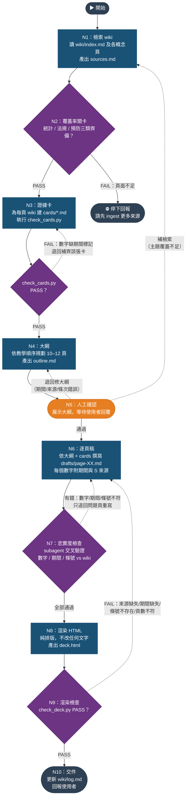

# topic-slides 流程圖

> 形狀說明：矩形 = AI 自動節點；菱形 = 自動化檢查關卡；圓角矩形 = 人工確認或終止點。
> 實線 = 正向推進；虛線 = 退回路線（標退回原因）。

## 停止條件

| 條件 | 動作 |
|------|------|
| 任何一關重試滿 **3 次** | 附加記錄至 `report.md`，停下回報使用者 |
| N2 覆蓋率不足 | 立即停下，請使用者先 ingest 來源 |
| 全部關卡 PASS | 進入 N10 交件 |

## 節點分工總覽

| 節點 | 類型 | 可讀 | 不可讀 | 產出 |
|------|------|------|--------|------|
| N1 | AI | wiki/ 全部 | raw/ | sources.md |
| N2 | 自動關卡 | sources.md | — | 無 |
| N3 | AI + 腳本 | sources.md, wiki/ | raw/ | cards/*.md |
| N4 | AI | sources.md, cards/ | — | outline.md |
| N5 | 人工 | outline.md | — | 無 |
| N6 | AI | outline.md, cards/ | wiki/, raw/ | drafts/page-XX.md |
| N7 | subagent | drafts/, wiki/（被引用頁） | cards/, outline.md, raw/ | review.md |
| N8 | AI | drafts/ | cards/, outline.md, wiki/, raw/ | deck.html |
| N9 | 腳本 | deck.html, wiki/ | — | 無 |
| N10 | AI | deck.html, report.md | — | log.md 追加 |
